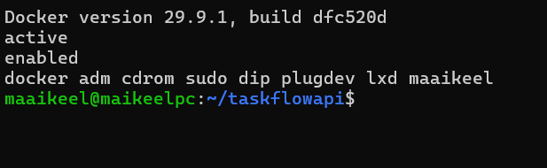
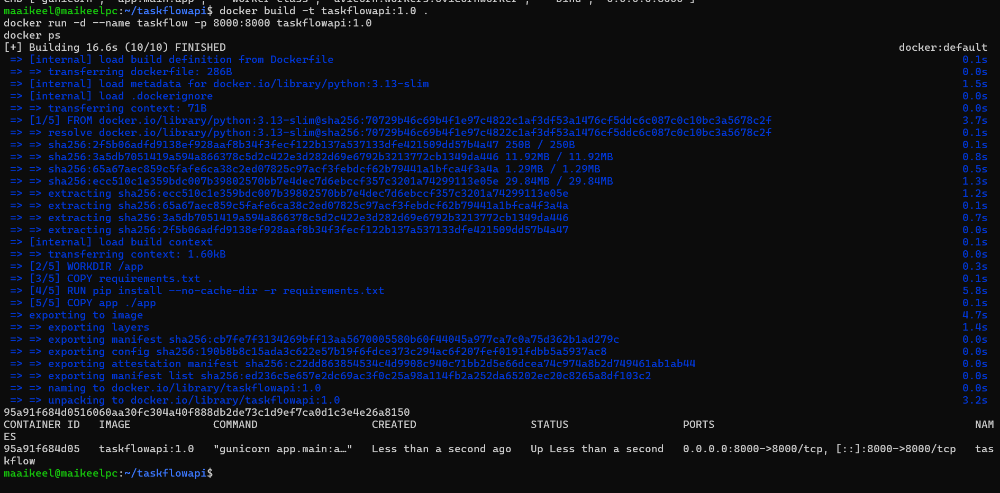
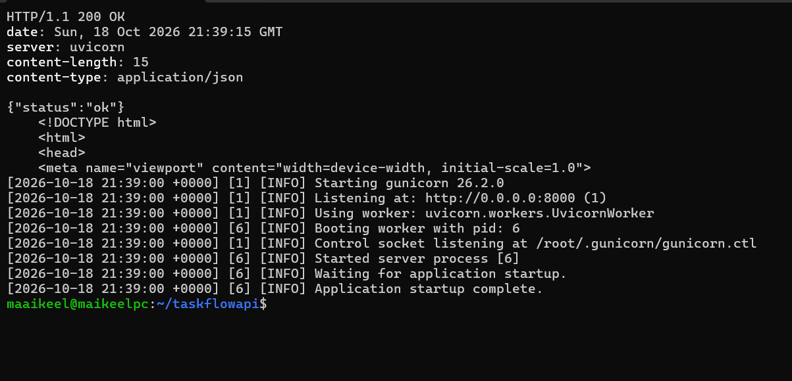
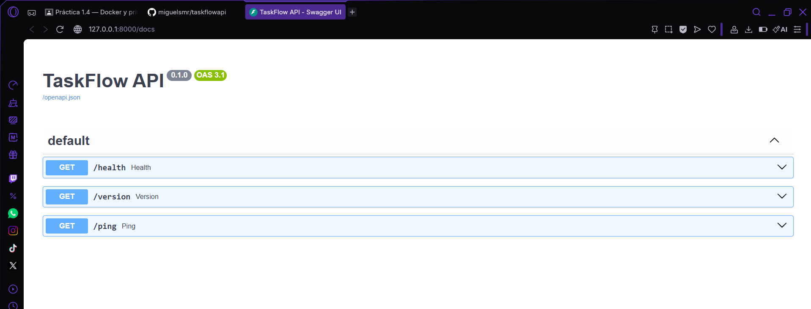
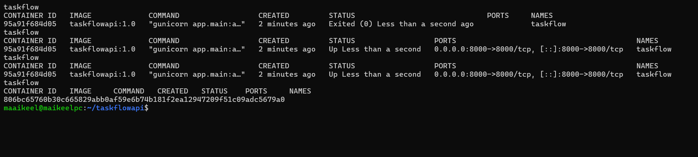

# Práctica 1.4 — Docker y primer contenedor (documento de pruebas)

**Alumno:** Miguel Luzón Prado · **Módulo:** Despliegue de Aplicaciones Web (2º DAW) · **Proyecto:** TaskFlow

**Entorno:** Ubuntu Server en VirtualBox (NAT con reenvío de puertos `2222→22` para SSH y `8000→8000` para la API), administrado por SSH desde Windows.

---

## 1. Instalación de Docker Engine

```bash
curl -fsSL https://get.docker.com | sudo sh   # script oficial: añade el repositorio de Docker e instala docker-ce, cli, containerd y plugins
```

### Post-instalación

```bash
sudo systemctl enable --now docker   # arranca el servicio y lo habilita al inicio del sistema
sudo usermod -aG docker $USER        # añade el usuario al grupo docker (usar docker sin sudo)
newgrp docker                        # aplica el grupo en la sesión actual sin cerrar sesión
```

| Paso | Para qué sirve |
|---|---|
| `systemctl enable --now docker` | `--now` arranca el demonio `dockerd` ahora y `enable` hace que arranque solo al reiniciar la máquina |
| `usermod -aG docker $USER` | El socket `/var/run/docker.sock` pertenece al grupo `docker`; al estar en él, el usuario puede usar `docker` sin `sudo` |
| `newgrp docker` | Recarga los grupos en la sesión actual (si no, hay que cerrar sesión y volver a entrar) |

> Seguridad: pertenecer al grupo `docker` equivale a tener privilegios de root en la máquina, así que solo se añade a usuarios de confianza.

### Verificación

```bash
docker --version
systemctl is-active docker    # → active
systemctl is-enabled docker   # → enabled
groups                        # → ... docker
```



Resultado: `Docker version 29.9.1`, servicio `active` y `enabled`, y el usuario `maaikeel` pertenece al grupo `docker` (por eso los siguientes comandos se ejecutan sin `sudo`).

---

## 2. Imagen Docker del backend

Se usa el código de la práctica 1.1 (`app/main.py` con `/health`, `/version` y `/ping`) y el `requirements.txt` con FastAPI, Uvicorn y Gunicorn.

### Dockerfile

```dockerfile
FROM python:3.13-slim
WORKDIR /app
COPY requirements.txt .
RUN pip install --no-cache-dir -r requirements.txt
COPY app ./app
EXPOSE 8000
CMD ["gunicorn", "app.main:app", "--worker-class", "uvicorn.workers.UvicornWorker", "--bind", "0.0.0.0:8000"]
```

| Instrucción | Qué hace |
|---|---|
| `FROM python:3.13-slim` | Imagen base oficial con Python 3.13 sobre Debian reducida (ligera) |
| `WORKDIR /app` | Directorio de trabajo dentro del contenedor |
| `COPY requirements.txt .` + `RUN pip install` | Instala las dependencias. Se copia antes que el código para aprovechar la **caché de capas**: si solo cambia el código, no se reinstalan |
| `COPY app ./app` | Copia el código de la aplicación |
| `EXPOSE 8000` | Documenta el puerto en el que escucha la aplicación |
| `CMD [...]` | Arranca Gunicorn con UvicornWorker (igual que en la práctica 1.3) |

En el contenedor se hace bind a **`0.0.0.0`** y no a `127.0.0.1`: el contenedor tiene su propia interfaz de red, y si escuchara solo en su loopback, Docker no podría reenviarle el tráfico del anfitrión. La exposición al exterior la controla `-p` en el anfitrión.

`.dockerignore` (lo que no se copia a la imagen):

```
venv/
__pycache__/
.git/
docs/
```

### Construcción

```bash
docker build -t taskflowapi:1.0 .
docker images
```

---

## 3. Arranque del contenedor

**Sentencia de arranque:**

```bash
docker run -d --name taskflow -p 8000:8000 taskflowapi:1.0
```

| Opción | Significado |
|---|---|
| `-d` | Modo *detached*: el contenedor corre en segundo plano |
| `--name taskflow` | Nombre del contenedor para gestionarlo fácilmente |
| `-p 8000:8000` | Publica el puerto: `puerto_anfitrión:puerto_contenedor` |
| `taskflowapi:1.0` | Imagen (`nombre:etiqueta`) construida antes |



La imagen se construye en 5 pasos (`FINISHED`) y `docker ps` muestra el contenedor `taskflow` en estado `Up` con el puerto `0.0.0.0:8000->8000/tcp`.

---

## 4. Verificación

```bash
curl -i http://127.0.0.1:8000/health      # 200 OK {"status":"ok"}
curl -s http://127.0.0.1:8000/docs | head -5   # HTML de Swagger UI
docker logs taskflow                       # log de Gunicorn dentro del contenedor
```



`/health` responde `200 OK` con `{"status":"ok"}`, `/docs` devuelve el HTML de Swagger UI, y el log muestra Gunicorn escuchando en `0.0.0.0:8000` con `UvicornWorker` dentro del contenedor (el máster es el **PID 1** del contenedor, porque es el proceso principal).

### Acceso a /docs (Swagger UI)

Con el reenvío de puertos de VirtualBox `127.0.0.1:8000 (Windows) → 8000 (VM)` y el `-p 8000:8000` de Docker, la documentación interactiva de FastAPI se abre desde el navegador de Windows en **http://127.0.0.1:8000/docs**:

```
Navegador Windows :8000 ──VirtualBox NAT──▶ Ubuntu :8000 ──docker -p──▶ contenedor :8000 (Gunicorn + Uvicorn + FastAPI)
```



Swagger UI muestra la **TaskFlow API** con los tres endpoints `GET /health`, `GET /version` y `GET /ping`.

---

## 5. Ciclo de vida del contenedor

```bash
docker stop taskflow      # parar (envía SIGTERM; Gunicorn cierra ordenadamente)
docker ps -a              # estado: Exited
docker start taskflow     # arrancar de nuevo el mismo contenedor
docker restart taskflow   # reiniciar (stop + start)
docker rm -f taskflow     # eliminar (-f lo para si está en marcha)
docker run -d --name taskflow -p 8000:8000 taskflowapi:1.0   # crear uno nuevo desde la imagen
```

| Comando | Estado resultante |
|---|---|
| `docker run` | Crea el contenedor desde la imagen y lo arranca → `Up` |
| `docker stop` | `Exited` (el contenedor existe pero no corre) |
| `docker start` | `Up` otra vez (mismo contenedor) |
| `docker restart` | `Up` (se reinicia el proceso) |
| `docker rm -f` | Desaparece de `docker ps -a`; la **imagen** se conserva |



Se ve el contenedor pasar a `Exited (0)` (parada limpia), volver a `Up` con `start` y `restart`, desaparecer de `docker ps -a` con `rm -f`, y crearse uno nuevo con `docker run` (nuevo ID `806bc65760b3…`).

Otros comandos útiles: `docker exec -it taskflow sh` (entrar al contenedor), `docker logs -f taskflow` (logs en vivo), `docker rmi taskflowapi:1.0` (borrar la imagen).
