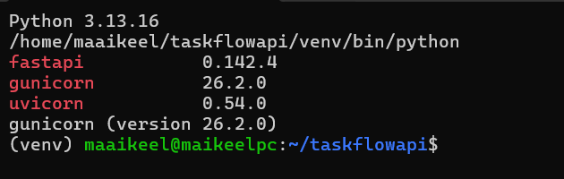
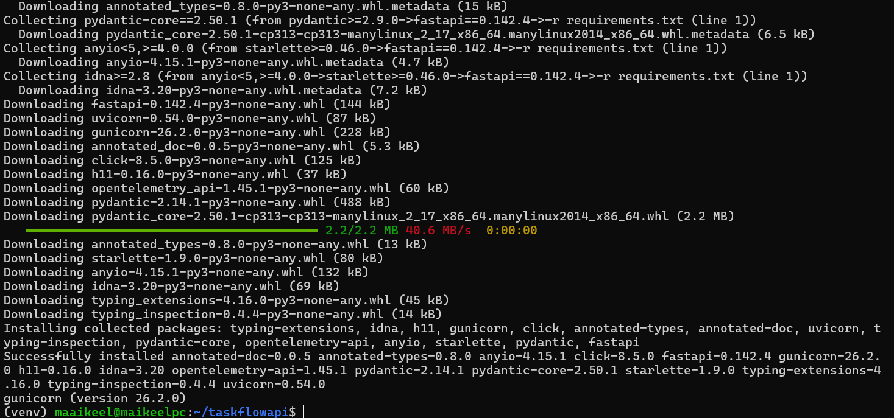
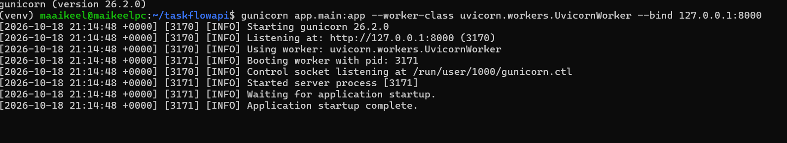
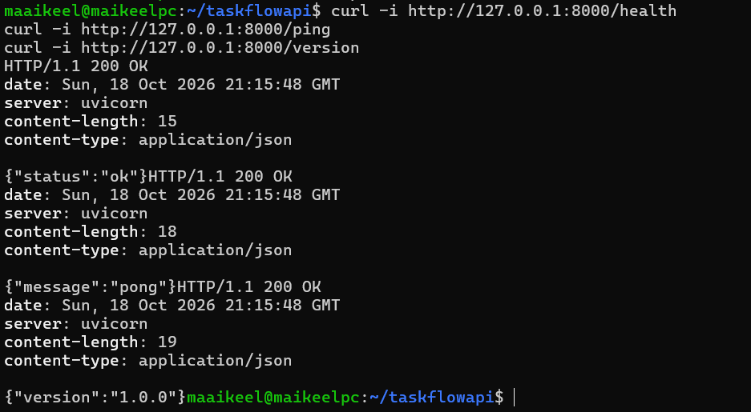
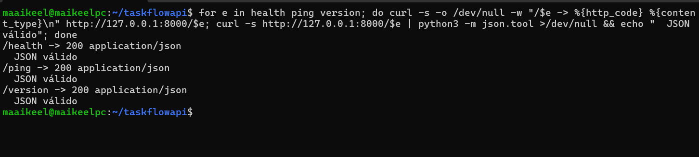
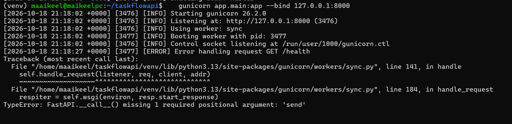
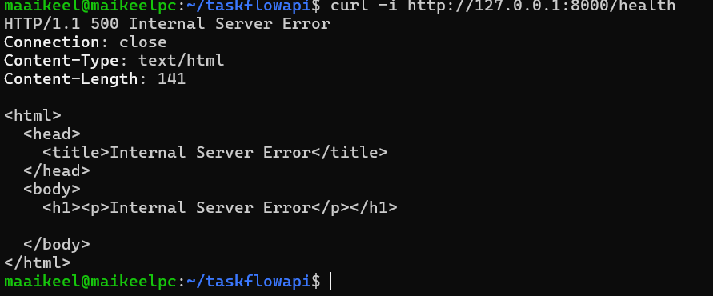

# Práctica 1.3 — Instalación básica de Gunicorn

**Alumno:** Miguel Luzón Prado · **Módulo:** Despliegue de Aplicaciones Web (2º DAW) · **Proyecto:** TaskFlow

Objetivo: instalar y verificar el servidor de aplicaciones **Gunicorn** sirviendo el backend de TaskFlow (FastAPI).

**Entorno:** máquina virtual **Ubuntu Server** en VirtualBox (red NAT con reenvío del puerto 2222 → 22), administrada por **SSH** desde Windows (`ssh -p 2222 maaikeel@127.0.0.1`). Gunicorn solo funciona en sistemas Unix, por eso se ejecuta en Ubuntu y no en Windows.

---

## 0. Estructura del proyecto

Se parte del repositorio `taskflowapi` de la práctica 1.1 y se añaden Gunicorn y la carpeta `docs/`:

```
taskflowapi/
├── app/
│   ├── __init__.py
│   └── main.py          # main.py de la práctica 1.1 (sin cambios)
├── docs/
│   ├── capturas/        # evidencias de esta práctica
│   └── gunicorn.md      # este documento
├── venv/                # entorno virtual (en .gitignore, no se sube)
├── .gitignore
├── README.md
├── practica1.md
└── requirements.txt     # + gunicorn
```

`requirements.txt` (se añade `gunicorn` a lo que ya había):

```text
fastapi==0.142.4
uvicorn==0.54.0
gunicorn==26.2.0
```

`app/main.py` (el de la práctica 1.1, sin modificar):

```python
from fastapi import FastAPI

app = FastAPI(title="TaskFlow API")


@app.get("/health")
def health():
    return {"status": "ok"}


@app.get("/version")
def version():
    return {"version": "1.0.0"}


@app.get("/ping")
def ping():
    return {"message": "pong"}
```

---

## 1. Pasos ejecutados

### 1.1 Conexión al servidor por SSH

En Ubuntu Server se instala y activa el servidor SSH:

```bash
sudo apt update
sudo apt install -y openssh-server
sudo systemctl enable --now ssh
```

En VirtualBox, el adaptador de red está en **NAT** con una regla de reenvío de puertos `TCP 127.0.0.1:2222 (anfitrión) → 22 (invitado)`. Desde Windows:

```powershell
ssh -p 2222 maaikeel@127.0.0.1                                   # conexión
scp -P 2222 Downloads\gunicorn.md maaikeel@127.0.0.1:~/          # copiar ficheros
```

### 1.2 Instalar Python 3.13+ y clonar el proyecto

Ubuntu 24.04 trae Python 3.12, así que se instala la 3.13 desde el repositorio *deadsnakes*:

```bash
sudo apt install -y software-properties-common git curl
sudo add-apt-repository -y ppa:deadsnakes/ppa
sudo apt update
sudo apt install -y python3.13 python3.13-venv

git clone https://github.com/miguelsmr/taskflowapi.git
cd taskflowapi
```

Se reutiliza el proyecto de la práctica 1.1 tal cual: `app/main.py` con `/health`, `/version` y `/ping`, y `app/__init__.py` vacío para que `app` sea un paquete de Python (necesario para que funcione la ruta `app.main:app`).

### 1.3 Añadir Gunicorn, crear el entorno virtual e instalar dependencias

```bash
echo "gunicorn==26.2.0" >> requirements.txt
python3.13 -m venv venv          # crea el entorno virtual
source venv/bin/activate         # lo activa (el prompt muestra "(venv)")
pip install -r requirements.txt  # fastapi, uvicorn, gunicorn
gunicorn --version
```

### 1.4 Arrancar Gunicorn

Desde la carpeta `taskflowapi` con el entorno activado:

```bash
gunicorn app.main:app --worker-class uvicorn.workers.UvicornWorker --bind 127.0.0.1:8000
```

### 1.5 Verificar con curl

En una segunda sesión SSH:

```bash
curl -i http://127.0.0.1:8000/health
curl -i http://127.0.0.1:8000/ping
curl -i http://127.0.0.1:8000/version
```

---

## 2. Evidencias de funcionamiento

### 2.1 Entorno virtual y versiones instaladas



- `(venv)` en el prompt: el entorno virtual está activo.
- `Python 3.13.16` y `which python` → `/home/maaikeel/taskflowapi/venv/bin/python`: se usa el Python del entorno virtual.
- Instalados: `fastapi 0.142.4`, `uvicorn 0.54.0`, `gunicorn 26.2.0`.

Instalación desde `requirements.txt`:



### 2.2 Arranque de Gunicorn



```
[2026-10-18 21:14:48 +0000] [3170] [INFO] Starting gunicorn 26.2.0
[2026-10-18 21:14:48 +0000] [3170] [INFO] Listening at: http://127.0.0.1:8000 (3170)
[2026-10-18 21:14:48 +0000] [3170] [INFO] Using worker: uvicorn.workers.UvicornWorker
[2026-10-18 21:14:48 +0000] [3171] [INFO] Booting worker with pid: 3171
[2026-10-18 21:14:48 +0000] [3170] [INFO] Control socket listening at /run/user/1000/gunicorn.ctl
[2026-10-18 21:14:48 +0000] [3171] [INFO] Started server process [3171]
[2026-10-18 21:14:48 +0000] [3171] [INFO] Waiting for application startup.
[2026-10-18 21:14:48 +0000] [3171] [INFO] Application startup complete.
```

- El proceso **máster** (PID 3170) escucha en `127.0.0.1:8000`.
- `Using worker: uvicorn.workers.UvicornWorker` confirma el tipo de worker.
- El **worker** (PID 3171) arranca un servidor Uvicorn y carga la aplicación FastAPI (`Application startup complete`).

### 2.3 Respuesta de los endpoints



| Endpoint | Código | Content-Type | Cuerpo |
|---|---|---|---|
| `/health` | `200 OK` | `application/json` | `{"status":"ok"}` |
| `/ping` | `200 OK` | `application/json` | `{"message":"pong"}` |
| `/version` | `200 OK` | `application/json` | `{"version":"1.0.0"}` |

### 2.4 Verificación de código 200 y JSON válido

```bash
for e in health ping version; do
  curl -s -o /dev/null -w "/$e -> %{http_code} %{content_type}\n" http://127.0.0.1:8000/$e
  curl -s http://127.0.0.1:8000/$e | python3 -m json.tool > /dev/null && echo "  JSON válido"
done
```



`python3 -m json.tool` da error si la respuesta no es JSON, así que si imprime "JSON válido" queda comprobado.

### 2.5 Verificación de que NO es una página por defecto

- Las respuestas son `application/json` con exactamente los datos definidos en nuestro `main.py` (`{"status":"ok"}`, `{"message":"pong"}`, `{"version":"1.0.0"}`), no una página HTML de bienvenida tipo "It works!" de Apache/Nginx.
- La cabecera `server: uvicorn` demuestra que responde el worker Uvicorn que corre dentro de Gunicorn, no un servidor web.

### 2.6 Gunicorn solo escucha en local

El log muestra `Listening at: http://127.0.0.1:8000`: solo acepta conexiones desde la propia máquina. Las pruebas con `curl` se hacen dentro del servidor (por SSH); desde fuera no se puede acceder al puerto 8000 (además, en NAT solo se reenvía el puerto 22 del SSH).

---

## 3. ¿Qué hace la orden y por qué UvicornWorker es obligatorio?

```bash
gunicorn app.main:app --worker-class uvicorn.workers.UvicornWorker --bind 127.0.0.1:8000
```

| Parte | Significado |
|---|---|
| `gunicorn` | Lanza el servidor de aplicaciones: un proceso **máster** que gestiona procesos **workers**. |
| `app.main:app` | `módulo:objeto`. Importa el módulo `app/main.py` (paquete `app`) y usa la variable `app` (la instancia de FastAPI). |
| `--worker-class uvicorn.workers.UvicornWorker` | Tipo de worker. En lugar del worker síncrono por defecto (`sync`, WSGI), cada worker ejecuta Uvicorn, que habla **ASGI**. |
| `--bind 127.0.0.1:8000` | Dirección IP y puerto donde escucha: solo la interfaz loopback, puerto 8000. |

Como no se indica `--workers`, arranca **1 worker** (en producción se suele usar `--workers 2*núcleos+1`).

### WSGI vs ASGI

- **WSGI** (Web Server Gateway Interface, PEP 3333) es el estándar clásico y **síncrono**: la aplicación es una función `app(environ, start_response)` que atiende una petición de principio a fin y devuelve la respuesta. Lo usan Flask y Django clásico. Es lo que entienden los workers por defecto de Gunicorn.
- **ASGI** (Asynchronous Server Gateway Interface) es su sucesor **asíncrono**: la aplicación es una corrutina `async app(scope, receive, send)`. Permite `async/await`, WebSockets, HTTP/2 y muchas conexiones concurrentes en un solo proceso.

**FastAPI es una aplicación ASGI** (basada en Starlette). Los workers por defecto de Gunicorn son WSGI, así que la llamarían con 2 argumentos en vez de 3 y fallaría. Lo comprobé arrancando **sin** `UvicornWorker` (worker por defecto, `sync`):

```bash
gunicorn app.main:app --bind 127.0.0.1:8000
curl -i http://127.0.0.1:8000/health
```

Log de Gunicorn (`Using worker: sync` y el error al recibir la petición):



```
[2026-10-18 21:18:02 +0000] [3476] [INFO] Using worker: sync
[2026-10-18 21:18:27 +0000] [3477] [ERROR] Error handling request GET /health
  File ".../gunicorn/workers/sync.py", line 184, in handle_request
    respiter = self.wsgi(environ, resp.start_response)
TypeError: FastAPI.__call__() missing 1 required positional argument: 'send'
```

Respuesta del cliente (`500 Internal Server Error` en HTML de Gunicorn, no el JSON de la API):



El worker WSGI llama a `app(environ, start_response)`, pero FastAPI espera `(scope, receive, send)`. **UvicornWorker hace de traductor**: Gunicorn gestiona los procesos y Uvicorn, dentro de cada worker, habla ASGI con FastAPI. Por eso es obligatorio.

---

## 4. ¿Por qué Gunicorn y no solo Uvicorn?

Uvicorn por sí solo ya puede servir FastAPI (`uvicorn app.main:app`), pero Gunicorn aporta la **gestión de procesos** que se espera en producción:

- **Proceso máster + varios workers**: aprovecha todos los núcleos de la CPU (cada proceso Python está limitado por el GIL).
- **Supervisión**: si un worker se cuelga o muere, el máster lo detecta (`--timeout`) y arranca otro automáticamente.
- **Recarga sin cortes**: con `kill -HUP` recarga código/configuración reiniciando workers de forma escalonada (graceful reload).
- **Señales y gestión**: `TERM` para parada ordenada, `TTIN`/`TTOU` para subir o bajar workers en caliente.
- **Configuración madura**: fichero `gunicorn.conf.py`, logs de acceso/errores, `--max-requests` para reciclar workers y evitar fugas de memoria.
- **Estándar de la industria**: es la combinación recomendada (Gunicorn como gestor + Uvicorn como worker) y encaja con systemd y un proxy inverso (Apache/Nginx) delante.

En resumen: **Uvicorn sabe hablar ASGI; Gunicorn sabe gestionar procesos**. Juntos tenemos lo mejor de ambos.

---

## 5. Concepto de servidor de aplicaciones

| | Servidor web (Apache/Nginx) | Servidor de aplicaciones (Gunicorn) |
|---|---|---|
| Función | Recibe peticiones HTTP del exterior, sirve estáticos (HTML, CSS, imágenes), TLS/HTTPS, proxy inverso | Ejecuta el **código Python** de la aplicación y genera respuestas dinámicas |
| Expuesto a Internet | Sí (puertos 80/443) | No, solo en local |
| Habla con | Navegadores/clientes | El servidor web (proxy) y la aplicación (WSGI/ASGI) |

Arquitectura de despliegue:

```
Cliente ──HTTP/HTTPS──▶ Apache (:80/:443) ──proxy──▶ Gunicorn (127.0.0.1:8000)
                                                       ├─ worker Uvicorn ─▶ FastAPI
                                                       └─ worker Uvicorn ─▶ FastAPI
```

Los **workers** son procesos independientes que atienden peticiones en paralelo; el máster solo los crea, vigila y reinicia.

### ¿Por qué Gunicorn solo escucha en 127.0.0.1?

- **Seguridad**: Gunicorn no está pensado para estar expuesto a Internet (no gestiona bien clientes lentos, no hace TLS, no filtra peticiones). Así nadie puede saltarse el proxy y atacarlo directamente.
- **Una única puerta de entrada**: todo el tráfico pasa por Apache, que aplica HTTPS, cabeceras de seguridad, logs, límites y sirve los estáticos.
- **Reducción de superficie de ataque**: el puerto 8000 no es visible desde fuera aunque el firewall estuviera mal configurado (evidencia en el apartado 2.6).

---

## 6. Puerto y bind

`--bind IP:PUERTO` indica **en qué interfaz de red y en qué puerto** escucha Gunicorn. En `--bind 127.0.0.1:8000`, `127.0.0.1` es la dirección y `8000` el puerto TCP. Por defecto (sin `--bind`) Gunicorn usa `127.0.0.1:8000`.

| Dirección | Qué significa | Accesible desde |
|---|---|---|
| `127.0.0.1` | Interfaz loopback IPv4 | Solo la propia máquina |
| `localhost` | Nombre que resuelve (vía `/etc/hosts`) a `127.0.0.1` (y/o `::1` en IPv6) | Solo la propia máquina. Depende de la resolución de nombres: puede acabar en IPv6 y no coincidir con un bind solo IPv4 |
| `0.0.0.0` | "Todas las interfaces IPv4" | Cualquier equipo que llegue a la IP de la máquina (red local o Internet). **Inseguro** para Gunicorn |

Se pueden poner varios binds (`--bind 127.0.0.1:8000 --bind unix:/run/taskflow.sock`); un socket Unix es otra opción habitual cuando el proxy está en la misma máquina.

---

## 7. Parar, arrancar y depurar

### Arrancar

```bash
cd taskflowapi && source venv/bin/activate

# Primer plano (ver logs en la terminal)
gunicorn app.main:app -k uvicorn.workers.UvicornWorker -b 127.0.0.1:8000

# Segundo plano con PID y logs en fichero
gunicorn app.main:app -k uvicorn.workers.UvicornWorker -b 127.0.0.1:8000 \
  --workers 2 --daemon --pid gunicorn.pid \
  --access-logfile access.log --error-logfile error.log
```

(`-k` = `--worker-class`, `-b` = `--bind`).

### Parar / recargar

```bash
# En primer plano: Ctrl+C
kill -TERM $(cat gunicorn.pid)   # parada ordenada
kill -HUP  $(cat gunicorn.pid)   # recarga workers sin cortar el servicio
kill -TTIN $(cat gunicorn.pid)   # +1 worker
kill -TTOU $(cat gunicorn.pid)   # -1 worker
pkill -f "gunicorn app.main:app" # si no hay fichero pid
```

### Comprobar estado

```bash
ps -ef | grep [g]unicorn
ss -ltnp | grep 8000              # (o: sudo lsof -i :8000)
curl -i http://127.0.0.1:8000/health
tail -f error.log
```

### Errores comunes

| Error | Causa | Solución |
|---|---|---|
| `gunicorn: command not found` | Entorno virtual no activado o Gunicorn no instalado | `source venv/bin/activate` y `pip install -r requirements.txt` |
| `ModuleNotFoundError: No module named 'app'` | Lanzado desde otra carpeta o falta `app/__init__.py` | Ejecutar desde `taskflowapi/` o usar `--chdir taskflowapi` |
| `ModuleNotFoundError: No module named 'fastapi'` / `'uvicorn'` | Dependencias sin instalar en el venv | `pip install -r requirements.txt` |
| `Connection in use: ('127.0.0.1', 8000)` | El puerto ya está ocupado (otro Gunicorn anterior) | `ss -ltnp \| grep 8000` y matar el proceso, o usar otro puerto |
| `TypeError: ... missing 1 required positional argument: 'send'` | Falta `--worker-class uvicorn.workers.UvicornWorker` (worker WSGI con app ASGI) | Añadir el worker de Uvicorn |
| `Failed to find attribute 'app' in 'app.main'` | La variable de FastAPI tiene otro nombre | Ajustar `módulo:variable` (p. ej. `app.main:application`) |
| `WORKER TIMEOUT` y reinicios | Una petición tarda más de 30 s | Revisar el código o subir `--timeout` |
| `curl: (7) Connection refused` desde otro equipo | Es lo esperado con bind a 127.0.0.1 | Acceder a través del proxy (Apache) |
| Error al instalar en Windows (`fcntl`) | Gunicorn no soporta Windows | Usar Linux / WSL / VM |
| Error de depuración general | — | Añadir `--log-level debug` para ver más detalle |

---

## 8. Criterios de aceptación

- [x] Python 3.13+ instalado (3.13.16) y entorno virtual `venv` creado y activo.
- [x] Dependencias instaladas desde `requirements.txt`.
- [x] Gunicorn 26.2.0 arrancando correctamente con UvicornWorker.
- [x] `/health`, `/version` y `/ping` responden 200 con JSON válido en el puerto 8000.
- [x] Documentación del proceso, verificación, parada/arranque y errores comunes.
