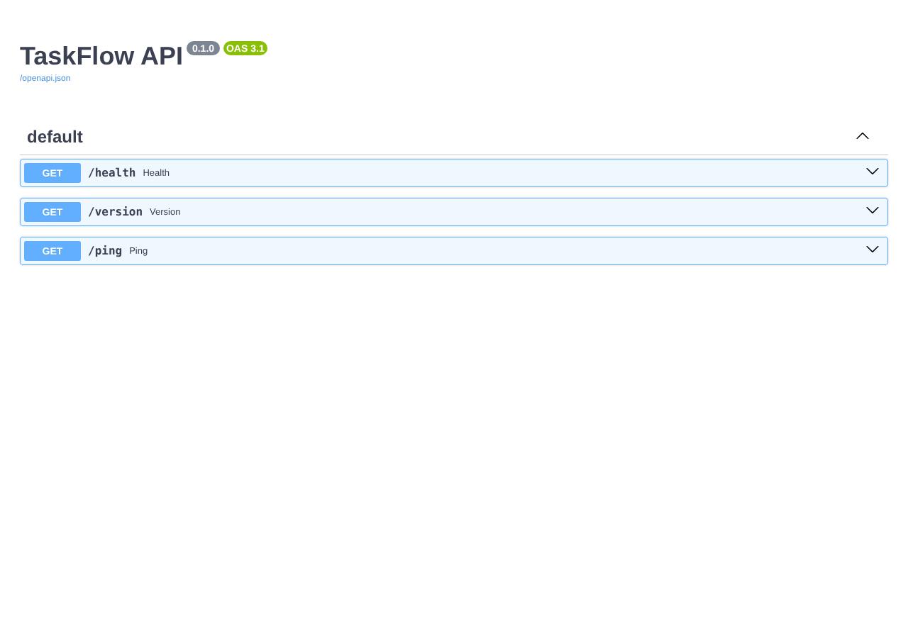

# Práctica 1.1 — Primeros endpoints y estructura inicial del proyecto

**Alumno:** Miguel Luzón Prado

## 1. Entorno virtual e instalación

```bash
python3 -m venv venv
source venv/bin/activate
pip install fastapi uvicorn
```

En `requirements.txt` se ponen las dependencias con su versión (sacada con `pip freeze`):

```
fastapi==0.142.4
uvicorn==0.54.0
```

## 2. Estructura

```
taskflowapi/
├── app/
│   ├── __init__.py
│   └── main.py
├── .gitignore
├── README.md
└── requirements.txt
```

## 3. Endpoints (app/main.py)

```python
from fastapi import FastAPI

app = FastAPI(title="TaskFlow API")


@app.get("/health")
def health():
    return {"status": "ok"}


@app.get("/version")
def version():
    return {"version": "1.0.0"}


@app.get("/ping")
def ping():
    return {"message": "pong"}
```

## 4. Arranque

```bash
uvicorn app.main:app --reload
```

El servidor arranca sin errores en http://127.0.0.1:8000

## 5. Captura de /docs


